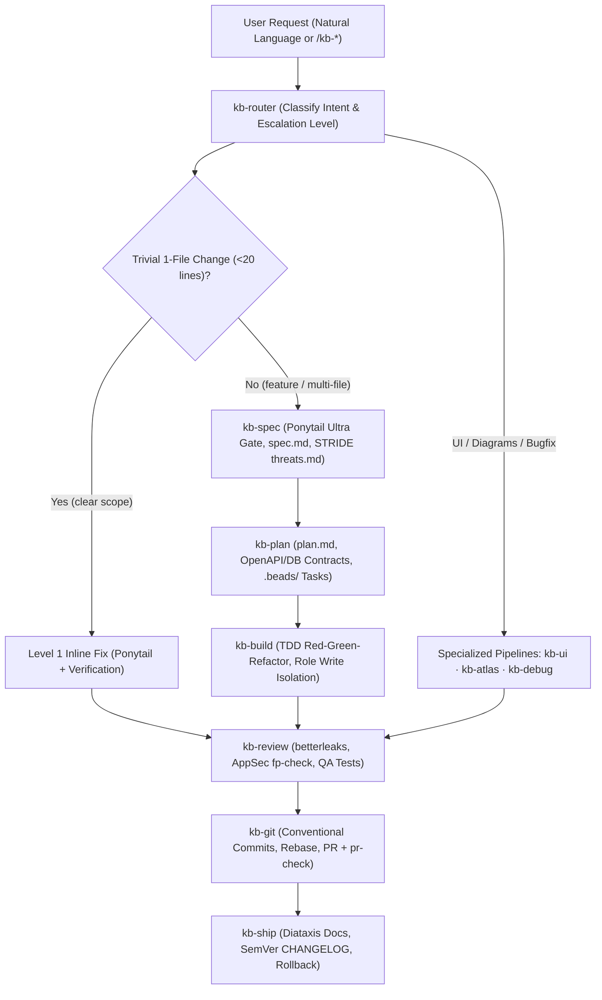
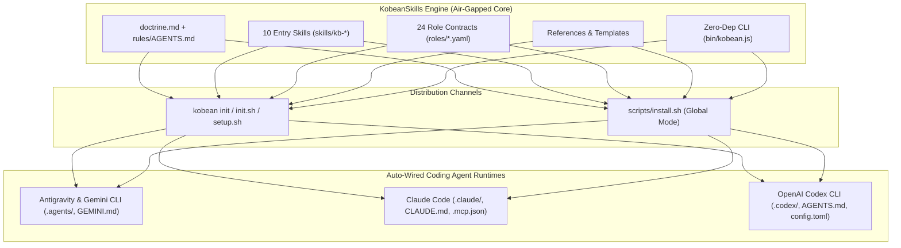
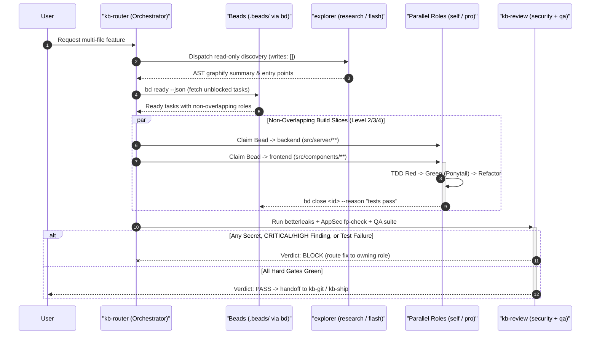
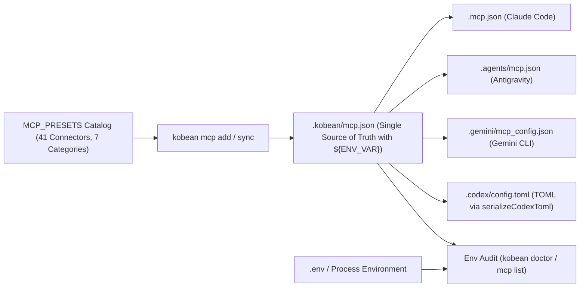
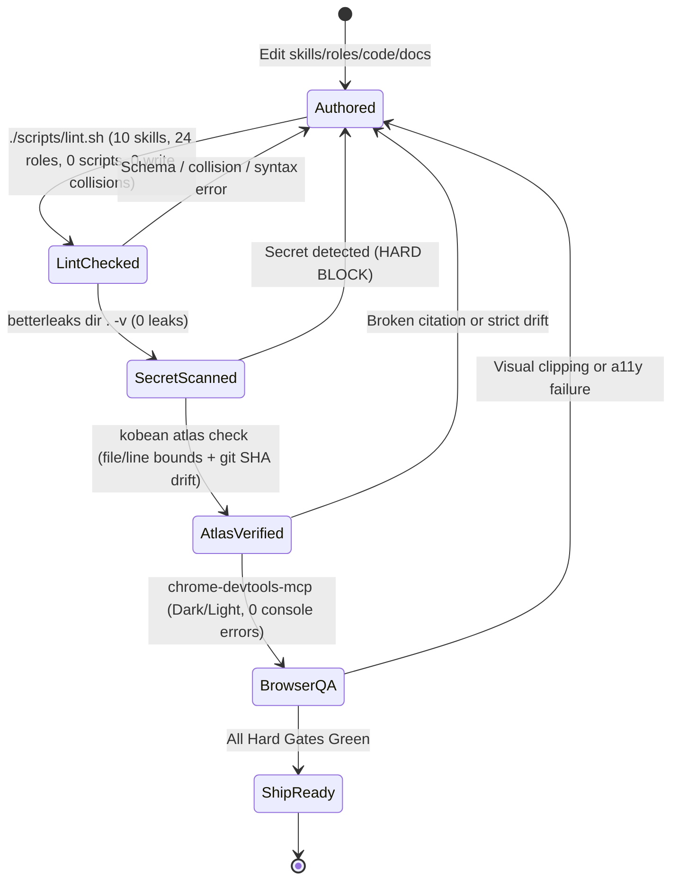

# KobeanSkills — Architecture & Engineering Workflow Atlas

> **Repository Identity:** `https://github.com/thienng-it/KobeanSkills.git` · **Pinned `HEAD`:** `939ac3d1` *(working tree dirty: includes uncommitted `kb-atlas`, `atlas-architect`, `content-architect`, and `model_tier` updates)*
> **Interactive Visual Explainer:** Open [workflow-explainer.html](./workflow-explainer.html) in any browser for clickable Semantic Passports, verified line citations, Dark/Light/Blueprint themes, and a 7-step animated Flow Trace.

---

## Mental Model in 30 Seconds

**KobeanSkills** is an **air-gapped, multi-agent engineering operating system** that turns a single declarative source of truth (`doctrine.md`, `10` progressive-disclosure `kb-*` skills, `24` strict YAML role contracts, stack/design references, and `templates/`) into one consistent engineering workflow across **Antigravity / Gemini CLI**, **Claude Code**, and **OpenAI Codex CLI**—backed by a zero-dependency Node CLI (`bin/kobean.js`) for scaffolding, cross-agent MCP sync, and deterministic verification.

Sources: [doctrine.md:1-30](../../doctrine.md#L1-L30), [rules/AGENTS.md:1-19](../../rules/AGENTS.md#L1-L19), [bin/kobean.js:781-864](../../bin/kobean.js#L781-L864)

---

## 1. End-to-End Engineering Workflow (`workflow`)

Every user request enters through global rules (`rules/AGENTS.md`) into **`kb-router`**, which classifies intent and enforces either the **Ponytail Fast-Path** (for trivial `< 20`-line 1-file fixes) or the **full Spec-Driven, TDD, Security-Gated lifecycle**.

### How Each Stage Protects Quality
| Stage | Entry Skill | Owning Role(s) | Core Artifact / Gate |
| :--- | :--- | :--- | :--- |
| **1. Route** | `kb-router` | Orchestrator | Selects pipeline, orchestration level (`L1`–`L4`), and model tier (`flash_lite`/`flash`/`pro`). |
| **2. Specify** | `kb-spec` | `explorer`, `po`, `threat-modeler` | Ponytail Ultra gate, `specs/NNN-<slug>/spec.md`, conditional STRIDE `threats.md`. |
| **3. Plan** | `kb-plan` | `architect`, `api-designer`, `data-engineer` | `plan.md`, API/DB contracts, and dependency-ordered `.beads/` issues via `bd`. |
| **4. Build** | `kb-build` | `backend`, `frontend`, `content-architect`, `data-engineer`, `mobile`, `ml-engineer`, `devops`, `refactorer` | Failing test first (Red), smallest complete code (Green), zero overlapping write globs. |
| **5. Specialize** | `kb-ui`, `kb-atlas`, `kb-debug` | `ui-ux-designer`, `atlas-architect`, `debugger` | Anti-slop UI craft (`chrome-devtools-mcp`), verified diagrams/wikis (`kobean atlas check`), or root-cause regression tests. |
| **6. Verify** | `kb-review` | `reviewer`, `security`, `supply-chain`, `performance`, `a11y-auditor`, `qa` | **Hard Block** on any secret (`betterleaks`), `CRITICAL`/`HIGH` AppSec bug, or failing test. |
| **7. Deliver** | `kb-git`, `kb-ship` | `release-manager`, `tech-writer`, `devops` | Linear rebase, optional PR materiality delta, Diátaxis release docs, SemVer `CHANGELOG.md`. |

Sources: [skills/kb-router/SKILL.md:23-37](../../skills/kb-router/SKILL.md#L23-L37), [skills/kb-spec/SKILL.md:21-55](../../skills/kb-spec/SKILL.md#L21-L55), [skills/kb-plan/SKILL.md:21-68](../../skills/kb-plan/SKILL.md#L21-L68), [skills/kb-build/SKILL.md:26-66](../../skills/kb-build/SKILL.md#L26-L66), [skills/kb-review/SKILL.md:24-79](../../skills/kb-review/SKILL.md#L24-L79), [skills/kb-git/SKILL.md:20-103](../../skills/kb-git/SKILL.md#L20-L103), [skills/kb-ship/SKILL.md:20-50](../../skills/kb-ship/SKILL.md#L20-L50)

---

## 2. System Context & Cross-Agent Distribution (`c4-architecture`)

KobeanSkills ships zero third-party runtime dependencies. Three entry installers (**`npx`/`bunx` via `bin/kobean.js`**, **`setup.sh`/`init.sh`**, and global **`scripts/install.sh`**) project the same `.kobean/` core into every major coding-agent discovery format automatically.

- **Project-Local Install (`kobean init` / `init.sh`):** Copies `doctrine.md`, `GUIDE.md`, `roles/`, `references/`, `templates/`, `skills/`, `rules/`, and `SOURCES.md` into `.kobean/`, then symlinks `.agents/skills/kb-*`, `.claude/skills/kb-*`, `.codex/skills/kb-*`, root rule files (`AGENTS.md`, `CLAUDE.md`, `GEMINI.md`), MCP configs, and `.github/pull_request_template.md`.
- **Global Zero-Config Install (`scripts/install.sh`):** Links shared assets into `~/.kobean/`, registers the Antigravity plugin in `~/.gemini/config/config.json`, and links all 10 `kb-*` skills into `~/.gemini/config/skills/`, `~/.claude/skills/`, and `~/.codex/skills/`.

Sources: [bin/kobean.js:781-864](../../bin/kobean.js#L781-L864), [init.sh:50-130](../../init.sh#L50-L130), [setup.sh:44-69](../../setup.sh#L44-L69), [scripts/install.sh:80-179](../../scripts/install.sh#L80-L179)

---

## 3. Multi-Agent Orchestration, Role Isolation & Smart Model Routing (`sequence`)

To prevent context bloat, token waste, and file-edit collisions, `kb-router` and `kb-build` pair **4 orchestration escalation levels** with **3 model tiers** (`flash_lite`, `flash`, `pro`) and **disjoint `writes` globs** verified by `scripts/lint.sh`.

### Escalation Ladder & Authority Precedence
1. **Authority Order:** `Explicit User Prompt` > `.kobean/constitution.md` > `doctrine.md` > `roles/<role>.yaml` > `skills/kb-*/SKILL.md` > `references/**`.
2. **Escalation Levels:** **L1 Inline** (`< 20` lines) $\rightarrow$ **L2 `invoke_subagent`** (isolated scout or 2–3 parallel roles) $\rightarrow$ **L3 `run_workflow`** ($N \ge 3$ fan-out/fan-in slices, e.g., monorepo `kb-atlas` or 5-role review) $\rightarrow$ **L4 `swarm`** (isolated `workspace: "share"` multi-worker branches).

Sources: [doctrine.md:7-14](../../doctrine.md#L7-L14), [doctrine.md:73-121](../../doctrine.md#L73-L121), [skills/kb-router/SKILL.md:39-51](../../skills/kb-router/SKILL.md#L39-L51), [skills/kb-build/SKILL.md:28-62](../../skills/kb-build/SKILL.md#L28-L62), [scripts/lint.sh:66-117](../../scripts/lint.sh#L66-L117)

---

## 4. Zero-Drift Cross-Agent MCP Synchronization (`dataflow`)

Instead of editing four incompatible MCP files by hand—or leaking plaintext API keys into Git—`bin/kobean.js` treats **`.kobean/mcp.json`** as the single declarative source of truth across **41 vetted marketplace connectors in 7 categories** (including `drawio`, `deepwiki`, and `gitdiagram`).

- **Zero-Leak Guarantee:** `extractEnvVars()` scans `${VAR}` references and audits whether `.env` or the shell provides them without ever writing secret values into tracked config files.
- **Dual-Transport Serialization:** `serializeCodexToml()` supports both stdio (`command` + `args`) and remote HTTP (`url`, e.g., `gitdiagram`) MCP servers cleanly.

Sources: [bin/kobean.js:18-561](../../bin/kobean.js#L18-L561), [bin/kobean.js:876-1113](../../bin/kobean.js#L876-L1113), [bin/kobean.js:1246-1310](../../bin/kobean.js#L1246-L1310)

---

## 5. Verification, Air-Gap Security & Atlas Freshness Lifecycle (`lifecycle`)

Every change—both inside `KobeanSkills` itself and inside target repositories using it—moves through deterministic automated gates before shipping.

Sources: [scripts/lint.sh:1-136](../../scripts/lint.sh#L1-L136), [bin/kobean.js:1687-1833](../../bin/kobean.js#L1687-L1833), [skills/kb-atlas/SKILL.md:67-76](../../skills/kb-atlas/SKILL.md#L67-L76), [skills/kb-review/SKILL.md:34-79](../../skills/kb-review/SKILL.md#L34-L79)
